<div align="center">



<br/>

<a href="https://github.com/ashudubeyvns"></a>
<a href="mailto:ashutoshdubeyvns@gmail.com"></a>
<a href="https://www.instagram.com/_ashutoshdubey0908_/"></a>


<br/>


</div>

---

## ⚡ `01 / ABOUT ME`

```java
public final class AshutoshDubey {
    String role = "Java Full Stack Architect";
    String focus = "Enterprise Backends & Distributed Systems";
    String backend = "Java • Spring Boot • REST APIs";
    String frontend = "React • TypeScript • Modern UI";
    String mindset = "Build it clean. Scale it thoughtfully.";
}
```

I’m **Ashutosh Dubey**, an MCA student and developer focused on scalable enterprise backend applications, Spring Boot services, modern React architectures, and distributed systems. I enjoy turning complex requirements into maintainable, practical software.

- 🎓 **MCA:** Galgotias University — **CGPA: 8.55 / 10.0**
- 🎓 **BCA:** Global Group of Institutes — **CGPA: 8.70 / 10.0**
- 💼 **Experience:** AICTE EduSkills Java Full Stack Virtual Intern · Wipro TalentNext Trainee
- 📬 **Email:** [ashutoshdubeyvns@gmail.com](mailto:ashutoshdubeyvns@gmail.com)
- 📸 **Instagram:** [@ashutoshdubey0908](https://www.instagram.com/_ashutoshdubey0908_/)

---

## 🛠️ `02 / TECHNICAL ARSENAL`

<div align="center">

### Languages


### Backend & APIs


`Spring Boot 3.5` · `Spring Data JPA` · `Hibernate ORM` · `Spring Security` · `REST APIs` · `JWT Authentication`

### Frontend


`React 19` · `Redux Toolkit` · `TanStack Query` · `Zustand` · `Tailwind CSS`

### Databases, Cloud & Tooling


`MySQL 8` · `MongoDB` · `Docker` · `AWS EC2 / S3 / Lambda` · `Apache Maven` · `Postman` · `Jira`

### Core Computer Science
`OOP` · `Data Structures & Algorithms` · `DBMS` · `Operating Systems`

</div>

---

## 🚀 `03 / FEATURED BUILDS`

<table>
<tr>
<td width="50%" valign="top">

### 🌌 NEXORA
**Social & Professional Networking Platform**

A networking ecosystem bringing together profiles, communities, short-form clips, and real-time communication.

- User profiles and communities
- **Nexora Clips** short-form video experience
- Messaging with WebRTC voice/video calling
- MySQL + MongoDB persistence

`React` `Spring Boot` `MySQL` `MongoDB` `WebRTC`

[↗ Explore on GitHub](https://github.com/ashudubeyvns)

</td>
<td width="50%" valign="top">

### ⚡ TaskGenZ
**Workspace & Delivery Management**

A full-stack project management workspace designed around task flow, collaboration, and project visibility.

- Drag-and-drop Kanban workflow
- JWT authentication and refresh tokens
- Threaded task comments
- Analytics dashboard

`React 19` `TypeScript` `Spring Boot 3.5` `MySQL` `MongoDB` `Vite`

[↗ Explore projects](https://github.com/ashudubeyvns)

</td>
</tr>
<tr>
<td width="50%" valign="top">

### 🏛️ College ERP Management System
**Academic Operations Platform**

A role-based ERP experience for managing core college workflows.

- Admin, faculty, and student roles
- Attendance tracking
- Student management
- MySQL-backed data storage

[↗ Live project](https://ashudubeyvns.github.io/ERP-Collage-management-system-main/)

</td>
<td width="50%" valign="top">

### ☕ BrainBrew Café
**Responsive Café Storefront**

A modern café website focused on a smooth browsing and shopping experience.

- Dynamic menu filtering
- Cart state management
- Responsive cross-device layouts
- Modern JavaScript interactions

[↗ Live project](https://ashudubeyvns.github.io/BrainBrew/)

</td>
</tr>
<tr>
<td colspan="2" valign="top">

### 📱 KidsApp Android Application
**Gamified Learning for Children**

A native Android learning app with interactive educational modules and smooth screen transitions.

</td>
</tr>
</table>

---

## 📊 `04 / GITHUB TELEMETRY`

<div align="center">

<a href="https://github.com/ashudubeyvns">
  
</a>
<a href="https://github.com/ashudubeyvns">
  
</a>


### Contribution Snake


</div>

---

## 🧭 `05 / DEPLOYMENT — VERCEL`

To deploy a web portfolio repository:

1. Push the project to your GitHub repository (for example, `AshutoshPortfolio`).
2. Sign in to [Vercel](https://vercel.com/).
3. Select **Add New → Project** and import the repository.
4. Confirm the framework and build settings match the project.
5. Select **Deploy** and check the deployment logs if the build fails.

> **Note:** This README is intended for your GitHub profile repository, `ashudubeyvns/ashudubeyvns`. The Vercel steps above are for a separate web portfolio project—not required to display this README.

---

<div align="center">


**“Build with clarity. Engineer for scale. Keep learning.”**

<a href="mailto:ashutoshdubeyvns@gmail.com">Let's connect</a> ·
<a href="https://github.com/ashudubeyvns">Explore my GitHub</a>

</div>
